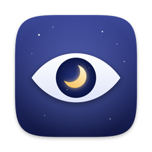
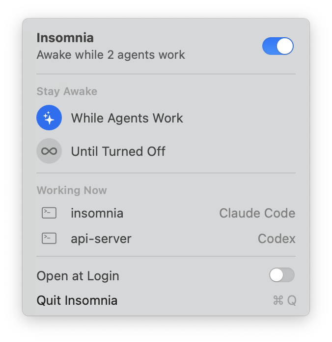

<p align="center">
  
</p>

<h1 align="center">Insomnia</h1>

<p align="center">Keeps your Mac awake while your coding agents work, even with the lid closed.</p>

<p align="center">
  <picture>
    <source media="(prefers-color-scheme: dark)" srcset="docs/menu-dark.png">
    
  </picture>
</p>

Insomnia lives in the menu bar. Turn it on, close the lid and put the Mac in your bag. Claude Code, Codex and the others keep working, and the Mac goes to sleep once they are done.

## Download

**[Download Insomnia](https://github.com/michalp1111/insomnia/releases/latest/download/Insomnia.zip)** for macOS 14 or later, on Apple silicon or Intel.

1. Open the downloaded `Insomnia.zip`, unless your browser already did, and drag **Insomnia** into your **Applications** folder.
2. Open Insomnia. It is not notarized by Apple yet, so the first time macOS refuses to open it. Click **Done**.
3. Go to **System Settings › Privacy & Security**, scroll down to the note about Insomnia and click **Open Anyway**, then confirm.

Insomnia now sits in the menu bar as a closed eye. Click it and flip the switch. The first time, macOS asks for your password once so that Insomnia can keep working with the lid closed. Turn on **Open at Login** to have it start with your Mac.

## How it works

- **While Agents Work** keeps the Mac awake only while an agent is actually working, and lets it sleep 5 minutes after the last one finishes.
- **Until Turned Off** keeps it awake until you say otherwise.
- The eye in the menu bar opens while Insomnia holds the Mac awake.

Insomnia recognizes Claude Code, Codex, Gemini CLI, Aider, OpenCode, Cursor Agent, Amp, Goose, Droid, Copilot CLI, Qwen Code, Crush, Cline, Auggie and Kiro, whether they run in a terminal or in the Claude app. An agent counts as working while data moves over its connections, while it runs a tool, or while its processes keep the CPU busy. One that sits waiting for you does not.

Everything stays on the Mac. Insomnia makes no network requests and collects nothing.

## The closed lid

macOS sleeps when the lid closes, whatever apps ask for. The only switch that overrides it is the system's `SleepDisabled` flag, and only an administrator can set it. The first time you turn Insomnia on, it asks for your password once and installs `/etc/sudoers.d/insomnia`, a rule that lets it run exactly these two commands without a password:

```
/usr/bin/pmset -a disablesleep 1
/usr/bin/pmset -a disablesleep 0
```

Nothing else gets elevated.

Safeguards:

- If Insomnia quits or crashes, a watchdog restores normal sleep within milliseconds.
- Below 10 % battery, or when the Mac runs too hot, Insomnia pauses.
- When the agents finish with the lid closed, Insomnia puts the Mac to sleep rather than leaving it running in your bag.

## Light on resources

Turned off, Insomnia does nothing at all. In Until Turned Off it only listens for system events. Watching agents takes a scan of a millisecond or two every 10 seconds, or every 30 seconds while they work, which stays under 0.1 % of one CPU core.

## Build from source

Requires the Command Line Tools (`xcode-select --install`).

```bash
scripts/build.sh release --install
```

This builds a universal app and installs it to `/Applications`. No Xcode project is needed.

## Uninstall

Quit Insomnia and move it to the Trash. To remove the closed-lid permission as well, run this in Terminal:

```bash
sudo rm /etc/sudoers.d/insomnia
```

---

<p align="center">Made by <a href="https://www.linkedin.com/in/michalptacek/">Michal Ptacek</a></p>
